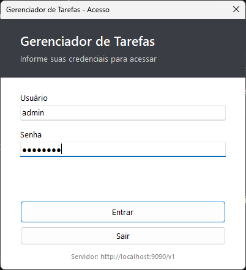
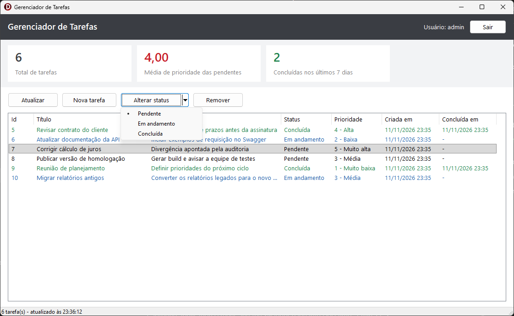
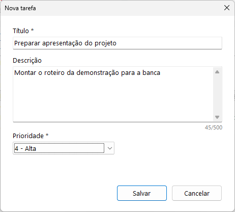
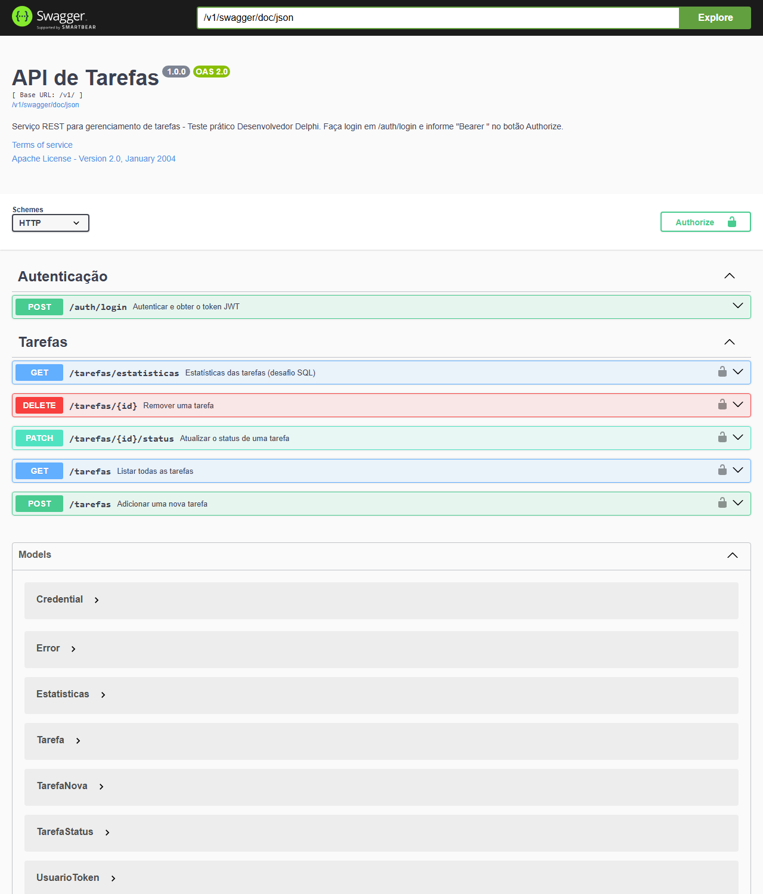

# Gerenciador de Tarefas – Teste prático Desenvolvedor Delphi

Solução do teste prático em duas partes: um **serviço REST** para gerenciar tarefas e uma **aplicação VCL** que consome esse serviço.

| Parte | Pasta | Descrição | Documentação |
| --- | --- | --- | --- |
| 1 | [`API/`](API) | Serviço em Delphi com Horse, JWT, Swagger e SQL Server | [API/README.md](API/README.md) |
| 2 | [`Aplicacao/`](Aplicacao) | Cliente VCL que usa RESTRequest4Delphi, sem persistência local | [Aplicacao/README.md](Aplicacao/README.md) |

## Requisitos atendidos

| Requisito do teste | Onde |
| --- | --- |
| Listar, adicionar, atualizar status e remover tarefas | API (`/v1/tarefas`) e telas do cliente |
| Desafio SQL: total, média de prioridade das pendentes e concluídas nos últimos 7 dias | `GET /v1/tarefas/estatisticas` e indicadores da tela principal |
| Estrutura de dados descrita | [API/README.md](API/README.md#estrutura-de-dados) e [`API/Database/01_create_database.sql`](API/Database/01_create_database.sql) |
| Framework Horse | API |
| Factory (Abstract Factory e Factory Method) | DAOs, serviços e conexão na API; serviços HTTP no cliente |
| Segurança na comunicação | Login com JWT; token apenas em memória no cliente |
| RESTRequest4Delphi | Todas as chamadas do cliente |
| Cliente sem persistência local | Nenhum dado é gravado em disco pela aplicação |

## Telas

### Aplicação cliente

Login:



Tela principal, com os indicadores do desafio SQL, a lista de tarefas e a troca de status:



Cadastro de nova tarefa:



### Swagger da API



## Como executar

Pré-requisitos: Delphi 13, [Boss](https://github.com/HashLoad/boss) e SQL Server com o driver ODBC instalado.

1. **Banco de dados** – execute [`API/Database/01_create_database.sql`](API/Database/01_create_database.sql) no SQL Server. O script cria o banco `TarefasBDMG`, as tabelas e o usuário padrão.

2. **API** – na pasta `API`:

   ```bash
   boss install
   ```

   ```bash
   msbuild AplicacaoBDMG_api.dproj /t:Build /p:Config=Debug /p:Platform=Win32
   ```

   Execute `Win32\Debug\AplicacaoBDMG_api.exe`. O serviço sobe em `http://localhost:9090/v1` e o Swagger fica em `http://localhost:9090/v1/swagger/doc/html`.

3. **Aplicação** – na pasta `Aplicacao`:

   ```bash
   boss install
   ```

   ```bash
   msbuild AplicacaoBDMG_app.dproj /t:Build /p:Config=Debug /p:Platform=Win32
   ```

   Execute `Win32\Debug\AplicacaoBDMG_app.exe` e entre com **`admin`** / **`admin123`**.

Os detalhes de configuração, endpoints, tratamento de erros e decisões de projeto estão nos READMEs de cada parte.
